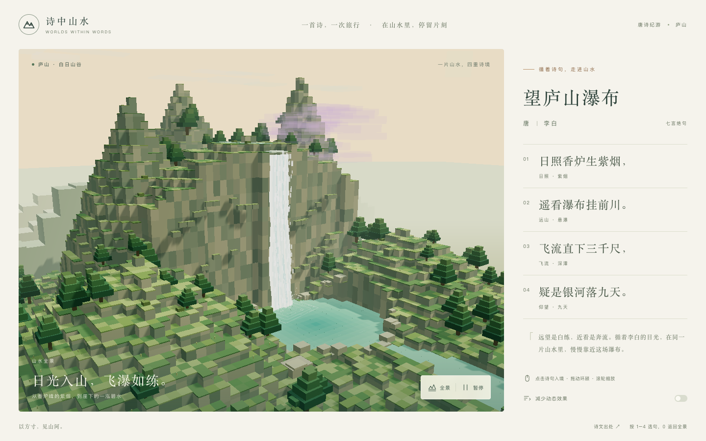

# 望庐山瀑布

循着李白的四句诗，在一片连续的体素山谷中看日照紫烟、悬崖飞瀑与深潭，感受从远望到仰观的变化。



## 本地运行

需要 Node.js 22.12+、pnpm。所有命令在本目录执行。

```sh
pnpm install
pnpm dev
```

开发服务默认地址为 `http://localhost:5173/lushan-waterfall/`，实际地址以终端输出为准。可通过 `pnpm dev --port 4185 --strictPort` 指定独立端口。生产构建与预览：

```sh
pnpm check
pnpm build
pnpm preview --port 4173 --strictPort
```

生产预览地址为 `http://localhost:4173/lushan-waterfall/`，`dist/` 是生成的生产文件。依赖锁定在 `pnpm-lock.yaml`；本地 pnpm 缓存放在已忽略的 `.pnpm-store/`。

## GitHub Pages 部署

目标地址：<https://echo-dm.github.io/lushan-waterfall/>。

首次部署前，在仓库 **Settings → Pages → Build and deployment → Source** 中选择 **GitHub Actions**。将配置推送到 `main` 后，工作流会使用 Node.js 22 和 `packageManager` 指定的 pnpm 版本，按锁文件安装依赖、构建并发布 `dist/`。也可在 **Actions → Deploy to GitHub Pages → Run workflow** 中选择 `main` 手动部署。

Vite 的 `base` 配置为 `/lushan-waterfall/`，对应仓库站点的资源路径。以 Actions 部署成功且目标地址可访问作为上线确认；本地构建成功仅代表本地验证通过。

## 走进山水

- 初始进入山水全景。点击任一句诗，用约 2.1 秒的相机漫游抵达对应视角；再次点击同一句可重新回到预设镜头。
- 拖动环顾，滚轮缩放；触屏使用单指环顾、双指缩放。拖动会中断飞行，连续选句会从当前位置转向最新目标。
- 点击“全景”返回；按 `1–4` 选句，按 `0` 返回全景。诗句按钮支持 Tab、Enter、方向键、Home 和 End。
- “暂停”停住水流、烟霞和涟漪，保留镜头控制。“减少动态效果”同时静止景物、直接切换镜头，并默认遵循系统设置。
- 图形不可用或连接中断时，完整诗文和出处仍可阅读；“重新进入山水”会重新初始化场景。

## 诗文与意象

采用《望庐山瀑布二首》其二，以简体字呈现：

> 日照香炉生紫烟，
> 遥看瀑布挂前川。
> 飞流直下三千尺，
> 疑是银河落九天。

原文核对：[香港教育局《望廬山瀑布》参考版本](https://cd.edb.gov.hk/chi/resource/ncs/download/js_list/JS_wanglushanbaobu.pdf)。该资料以繁体字书写；页面统一转为简体，保留“挂前川”“九天”的版本。组诗篇目另以[维基文库《望庐山瀑布水二首》](https://zh.wikisource.org/zh-hans/望廬山瀑布水二首)核对。本次选择由用户确认为其二。

| 诗句 | 景物与区域 | 镜头 |
| --- | --- | --- |
| 日照香炉生紫烟， | 香炉峰、日光、紫色水雾 | 侧望峰顶 |
| 遥看瀑布挂前川。 | 同一座悬崖、整条瀑布与碧潭 | 山谷远眺 |
| 飞流直下三千尺， | 瀑流、崖壁、水花与深潭 | 从侧旁俯看落水 |
| 疑是银河落九天。 | 从潭边望见瀑顶与高天 | 仰望瀑水 |

“三千尺”通过高低尺度表达夸张诗意，不作为地理测量。“银河”以银白水线与日光中的微光表达比喻。深潭、溪流、松树、观景石和背景山脊是连接空间的视觉补充；这是一片诗意构想，未复原具体景区地形。

## 实现与验收

React + TypeScript + Vite + Three.js。景物通过真实 3D 方块程序化生成，重复几何使用 `InstancedMesh`。四句共用一个场景、渲染器和坐标系；选择诗句只改变镜头。没有运行时图片、模型或远程字体请求。

| 文件 | 职责 |
| --- | --- |
| `src/poem.ts` | 原文、出处、稳定句子 ID、描述、相机与目标坐标及观察限制 |
| `src/App.tsx` | 导航状态、键盘操作、暂停与减少动态效果 |
| `src/WorldView.tsx` | React 生命周期、加载和错误界面、恢复 |
| `src/world.ts` | 渲染、可中断镜头飞行、OrbitControls、资源清理与质量调整 |
| `src/landscape.ts` | 同一山谷的地形、松树、瀑布、水雾与涟漪 |
| `src/voxel.ts` | 实例化方块与固定随机种子 |

移动画幅限制像素密度、关闭阴影、减少植被与粒子；持续低帧率时进一步降低像素密度。页面隐藏时停止绘制。卸载时取消动画循环、断开尺寸监听、清理事件和 GPU 资源。

浏览器验收使用已安装的 `agent-browser`：先启动生产预览，再执行：

```sh
pnpm qa http://127.0.0.1:4173/lushan-waterfall/
```

验收脚本使用独立浏览器会话，保存截图和 `docs/qa-results.json`；多指触控、指定画布坐标的滚轮和受控图形失败使用该会话的 CDP。运行结果和覆盖边界见 [验收记录](docs/acceptance.md)。只读 `window.__lushan.state` 提供首帧、当前镜头、转场、相机、绘制成本和动画时间，便于核对实际运行状态。
